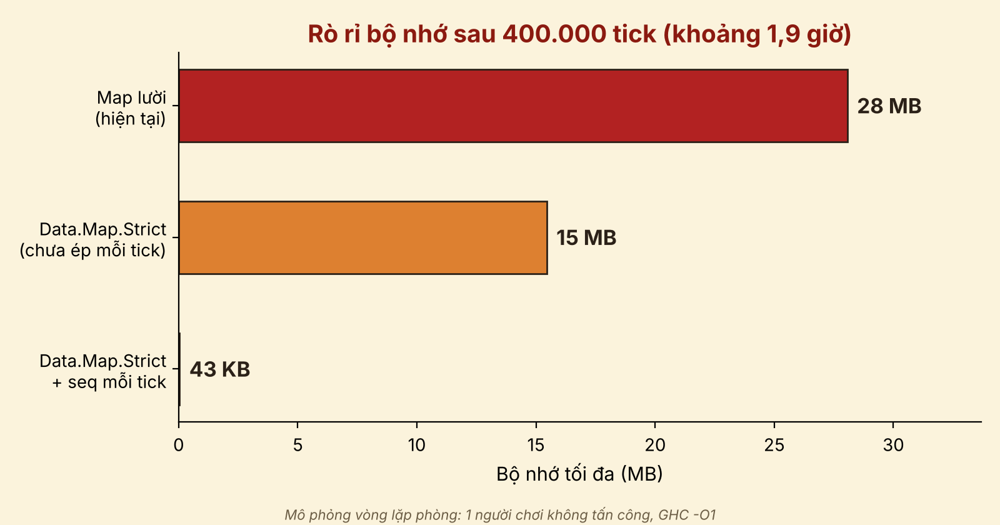

# Đo rò rỉ bộ nhớ do lazy evaluation

Đỗ Đăng Ninh sửa lại

Mô phỏng vòng lặp phòng của server: một người chơi **không tấn công**, bảng thời gian hồi đòn (`Cooldowns = Map Int Float`) được cập nhật mỗi tick, lặp **400.000 tick** (khoảng 1,9 giờ ở 60 tick/giây). Cách cập nhật bảng bắt chước hàm `applyInputs` trong `server/src/Logic/Control.hs` và vòng lặp `roomLoop` trong `server/src/RoomLoop.hs`.

## Nguyên nhân

Khi người chơi không tấn công, điều kiện `not (inAttack inp) || cd > 0` dừng ngay ở vế đầu nên không ai đọc giá trị `cd`. Bảng lười nối thêm một phép tính chưa được tính (thunk) mỗi tick, và thunk mới giữ lại thunk của tick trước. Bộ nhớ vì thế tăng dần theo thời gian chơi.

## Ba phiên bản so sánh

| File | Cách viết |
|---|---|
| `Lazy.hs` | `Data.Map` lười, không ép gì (đúng như code hiện tại) |
| `Strict.hs` | `Data.Map.Strict`, chưa ép bảng mỗi tick |
| `StrictSeq.hs` | `Data.Map.Strict` và ép bảng mỗi tick bằng `seq` |

## Cách chạy

```bash
ghc -O1 -rtsopts Lazy.hs
./Lazy +RTS -s
```

Làm tương tự với `Strict.hs` và `StrictSeq.hs` (trên Windows dùng `.\Lazy.exe +RTS -s`). Đọc dòng **maximum residency** trong thống kê mà GHC in ra: đó là lượng bộ nhớ lớn nhất còn sống trong heap.

## Kết quả đo (GHC 9.10.3, `-O1`, Windows)

| Phiên bản | maximum residency |
|---|---|
| `Lazy.hs` | 28.072.960 byte (khoảng 28 MB) |
| `Strict.hs` | 15.453.424 byte (khoảng 15 MB) |
| `StrictSeq.hs` | 42.856 byte (khoảng 43 KB) |



Biểu đồ được vẽ bằng `ve_bieu_do.py` (cần `pip install matplotlib`, chạy `python ve_bieu_do.py`). Muốn đổi số liệu thì sửa ba biến ở đầu file.

## Lưu ý

- Đây là **mô phỏng chỉ có phần bảng thời gian hồi đòn**, không phải đo trên game thật. Con số tuyệt đối phụ thuộc vào mô phỏng, điều quan trọng là xu hướng: lười > strict > strict + `seq`.
- Muốn đo trên server thật: thêm `-rtsopts` vào `ghc-options` của `server.cabal`, chạy `cabal run server -- +RTS -s`, tạo một phòng và đứng yên vài phút, tắt server rồi đọc dòng **maximum residency**.
